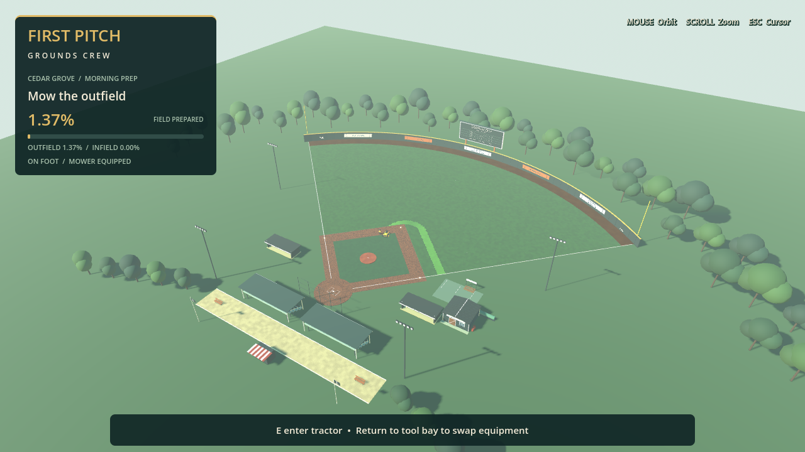
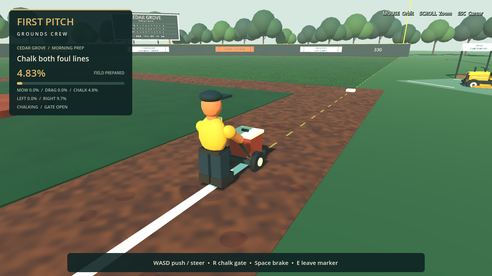
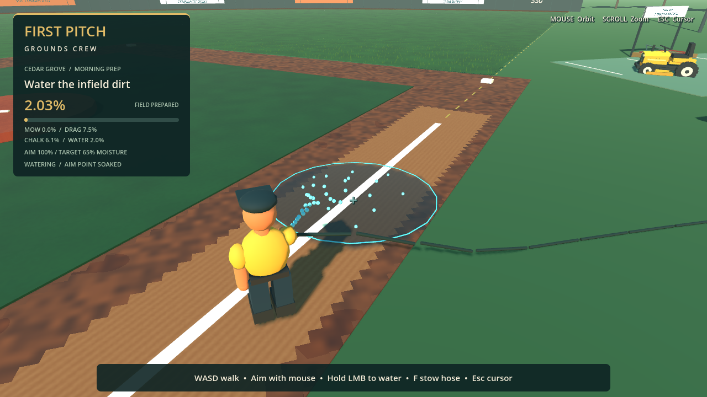
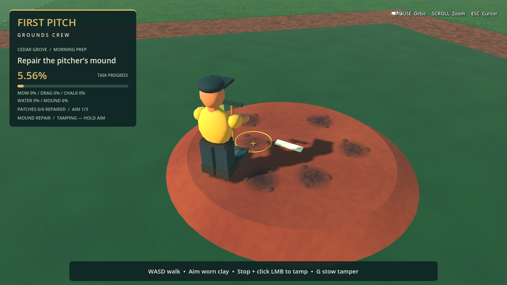
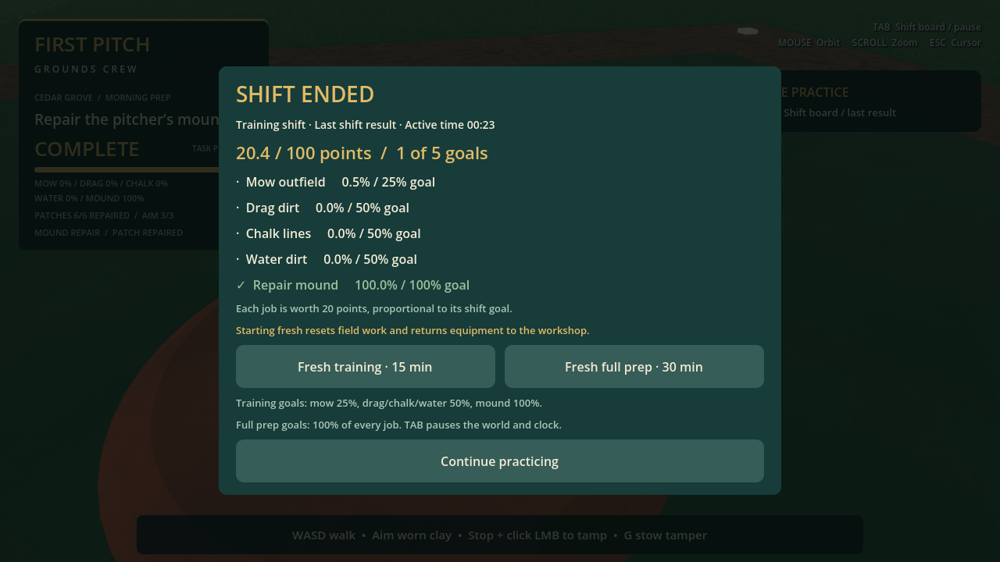
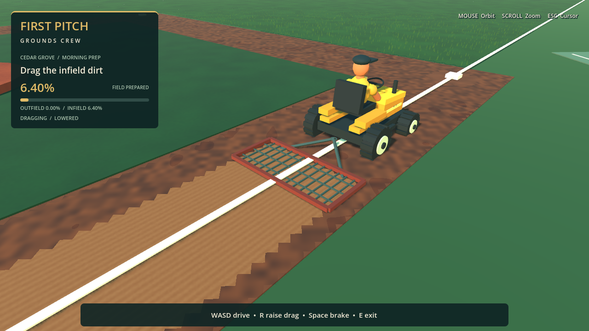

# First Pitch: Grounds Crew

A native Godot 3D baseball groundskeeping prototype. Walk through a small ballpark, enter a riding mower, and cut persistent stripes into the outfield. Built with GDScript and procedural meshes; no plugins or downloaded art are required.



## Open and play

Tested with **Godot 4.6.3 stable**, the installed stable 4.x version. Import `project.godot` into Godot, open `scenes/main/main.tscn`, and press **F6**, or press **F5** to run the project. The project defaults to **Forward+** for a desktop GPU. Windows PC is the intended platform; a Windows executable has not been exported or tested.

```sh
godot --editor --path .
godot --path .
```

If your graphics device cannot run Forward+, use Godot's Compatibility renderer (or launch with `--rendering-method gl_compatibility`). That override was used for software-rendered graphical checks in the cloud; it does not change the saved desktop renderer.

## Controls

| Action | Input |
| --- | --- |
| Walk / steer and drive mower | WASD |
| Sprint on foot | Shift |
| Jump on foot / brake mower | Space |
| Enter nearby tractor / exit when stopped | E |
| Swap mower deck / infield drag (on foot, by parked tractor at tool bay) | Q |
| Raise drag / lower when stopped and seated; open/close chalk gate while pushing | R |
| Take hose near water station / stow hose anywhere on foot | F |
| Take tamper near repair rack / stow tamper anywhere on foot | G |
| One timed tamping stroke while holding tamper | Click left mouse button |
| Spray while holding hose and cursor captured | Hold left mouse button |
| Orbit third-person camera | Mouse |
| Zoom camera | Mouse wheel |
| Open / close shift board and pause | Tab |
| Release or recapture cursor (does not pause) | Escape |

Spawn beside the equipment shed. The mower is ahead, on the paved equipment pad. Approach until **Press E to enter mower** appears. Drive across the foul line onto grass. Cutting starts automatically while driving. Dirt does not contribute to the percentage. Repeated passes count only once. Exit after stopping; your cut pattern stays for this session.

## M4 — Infield dragging

The tractor now accepts a tow-behind drag as well as its mowing deck. Start beside the workshop, approach the parked tractor on foot, and press **Q** to swap tools. The tool bay displays the unused equipment. Swapping requires a stopped tractor within 9 m of the bay and a player within 3.5 m of the tractor; you cannot change tools while driving or out on the field.

Press **E** to enter, drive onto a dirt basepath, stop, then press **R** to lower the drag. Drive forward to smooth the dirt into a lighter, fine-grooved finish. The working footprint is a swept, oriented **2.8 × 1.2 m rectangle**, tracked by a separate **250 × 265** condition mask. Dragging reduces maximum forward speed to **4 m/s**. You may raise the attachment at any time; lowering needs a stopped tractor. Reversing remains possible but does not prepare dirt.

Grass, the decorative infield lawn, mound, bases, and the batter/plate area are excluded from dirt progress. Overlapping passes count once. The HUD shows the equipped tool's objective and progress, plus all five task percentages. Stop and exit to inspect the prepared path; it stays prepared for the session. Return to the bay and press Q to resume mowing. The two tasks never count toward each other's progress.

The drag follows the tractor as an arcade attachment; it has no independent trailer collision or articulated towing physics. A compaction-based mound-repair tool is described below.

## M4 — Chalk marker

A separate **pushable chalk marker** is parked on the workshop pad, beside the tool bay. Walk to it and press **E**. WASD pushes and steers, **R** opens/closes the chalk gate, **Space** brakes, and **E** lets go after stopping. The operator visibly holds the handle and walks with the cart. Mower and tractor controls stay inactive while pushing.

The two foul lines now begin as **dashed gold guides**, rather than finished white stripes. Push forward along a guide with the gate open to lay a persistent white trail. The gate starts closed and automatically closes when you leave the marker. Reverse or stationary travel does not paint. Close the gate before repositioning so you do not leave unwanted marks.

Coverage is tracked in approximately **0.25 m target sections** on the left and right lines, from 0.8 to 103 m from home plate. Bases and the plate are protected. The HUD shows each line's completion and the total. Actual chalk strokes are **0.22 m wide**; off-guide strokes remain visible but earn no line credit. Repeated passes count once. All five task percentages remain independent, and park completion requires every task's full tracked count.

Chalk trails use small persistent mesh batches, refreshed at most 10 times per second, rather than a node for each paint sample. Their height follows the current park's dirt, lawn, and track surfaces. Chalk is session-only, has unlimited supply in this prototype, and is not erased by mowing or dragging yet. The batter's boxes remain decorative and are not part of the chalk objective.



## M4 — Hose watering

The **water station** stands beside the workshop and visitor dugout. Approach within 3 m on foot and press **F** to take the hose. Walk normally, aim the center reticle at the dirt, and **hold the left mouse button** to spray. F stows the hose from anywhere. Entering the tractor or chalk marker also stows it automatically. Escape releases the cursor and stops spraying so you can interact outside the game safely.

Water accumulates over time in a separate dirt-moisture mask. The **1.8 m radius** spray has a softer falloff at its edges. Each valid dirt cell counts once when it reaches **65% moisture**, not merely when a droplet passes over it. The reticle turns blue and the HUD reports the aim point's moisture when it is sufficiently soaked. The edges may still need more exposure. Wet dirt darkens and gains a slightly smoother finish while preserving existing drag grooves and chalk.

The hose can water within **65 m of its station**, and the nozzle has a **12 m spray reach**. Walls and other colliders block the spray. Grass, the decorative infield lawn, mound, bases, and batter/plate area do not count toward watering. Watering does not advance mowing, dragging, or chalking. Park readiness now requires all five full task counts.

This prototype has no drying, overwatering penalties, limited water supply, or physical rope simulation. The drawn hose follows a simple curve and can pass through props; reach checks and spray obstruction are separate from that visual. Moisture persists for the current session only. You cannot swap tractor attachments with a hose in hand; stow it or enter the tractor first.



## M4 — Mound repair

The **tamper rack** is outside the workshop. Approach it on foot and press **G** to take the tool. Walk onto the pitcher's mound, aim the reticle at a dark clay patch, stop, and **click LMB** for one tamping stroke. Keep the patch under the reticle until impact. Three separate strokes repair one patch; there are **six patches / eighteen valid strokes** in total. The HUD shows both repaired patches and the aim patch's hit count.

Each accepted impact settles the loose clay and blends away the worn spot. Completed patches turn the target ring blue and cannot be farmed for more progress. Holding the mouse does not auto-repeat; wait for the stroke to finish before clicking again. Moving, looking away, being too far away, an obstacle, or a released cursor prevents the impact from counting. The pitching rubber and ordinary infield dirt are not repair targets.

G stows the tamper anywhere. Taking the hose stows it automatically, and taking the tamper stows the hose. Entering the tractor or chalk marker also stows it. Cancelled windups do not repair a patch; already completed impacts persist for the session.

The mound now has a shallow sloped edge and matching convex collision, so you can walk up and stand on its top. This is compaction-based prototype repair, not digging, clay inventory, or deformable-terrain simulation. The character/tool animation is procedural rather than a rigged hand-contact animation.



## M5 — Timed preparation shifts

You begin in **free practice**, with no countdown. Press **Tab** to open the shift board and pause the world. Choose **Fresh training** for 15 minutes (mow 25%, drag/chalk/water 50% each, mound 100%) or **Fresh full prep** for 30 minutes and 100% of every job. Starting fresh resets all field work and returns equipment to the workshop.

The live checklist shows your goals and remaining time. Each job earns up to 20 points, proportional to its quota. Full-completion goals require exact tracked counts. Finish all five goals, run out of time, or use **End shift now** on the board to see results. Results stay fixed when you continue practicing; a new shift starts a clean attempt. Tab pauses both the world and clock; Escape outside the board only releases the cursor.

These are initial coverage-based challenges. Timings still need human playtesting; finish-quality penalties, saved results, and career progression are future work.



## Implemented M1–M3

- 27.43 m basepaths, dirt diamond, mound, bases, foul lines, grass outfield, warning track, padded outfield wall, dugouts, bleachers, scoreboard, light towers, shed, and mower parking.
- Collidable ground, buildings, stands, and outfield fence; daylight and shadows.
- Visible groundskeeper, walking, sprinting, jumping, orbit/zoom camera with spring-arm collision.
- Arcade CharacterBody3D mower: acceleration, reverse, speed-dependent steering, braking, rotating wheels, steering animation, protected exit placement.
- Spatial 450 × 330 grass-state image. Swept 2.4 m cutting footprint, overlap-safe unique-cell percentage, dirt exclusion, directional cut color, dirty-only updates capped at 10 Hz.
- HUD with mode, objective, contextual controls, percentage, and progress bar.

## Visual pass — Cedar Grove Ballpark

The park now follows a warm small-town palette: deep teal, cream trim, golden mower paint, and brick-red dirt. The visual pass adds a manicured infield island, covered seat rows, open bench-lined dugouts, a clapboard workshop with tools and a tarp cart, a detailed scoreboard, community signs, concourse benches, a ticket booth, and a surrounding tree line. The island is decorative; the current objective still scores only the outfield.

The mower has a grille, fenders, lights, treaded wheels, a ring-and-spoke steering wheel, and a visible seated groundskeeper. The walking character has a cap, workwear details, and a simple procedural walk cycle. A compact HUD and 4× MSAA improve presentation.

Uncut grass has 28,000 deterministic crossed-triangle tufts in one MultiMesh. They sway gently and shrink out beyond 38 m. The existing spatial mask hides cut tufts immediately when its texture updates. Repeated seats are also drawn using MultiMesh batches, and solid materials are shared by color. This remains procedural prototype art; the pass does not introduce imported models or textures.



## Project map

Start with `scenes/main/main.tscn` and `scripts/gameplay/game.gd` for scene composition and interactions. Then inspect `scripts/vehicles/mower.gd` and `scripts/mowing/grass.gd` for driving and cutting. `scripts/gameplay/stadium.gd` composes the ballpark; `scripts/environment/park_props.gd` builds reusable park props using shared geometry helpers. `scripts/vehicles/mower_visual.gd` and `scripts/player/crew_visual.gd` hold appearance code, separate from movement. The HUD is in `scripts/ui/grounds_hud.gd`. Dirt accounting and tool service live in `scripts/infield/`; the tow-behind visual is in `scripts/vehicles/drag_attachment.gd`. `scripts/mound/` contains repair state, tamper appearance, and the timed hand-tool controller. `scenes/environment/mound_repairs.tscn` exposes patch layout and stroke requirements; `tamper_rack.tscn` exposes pickup position, reach, and stroke timing. `scripts/watering/` holds moisture accounting and the hose controller. Open `scenes/environment/dirt_moisture.tscn` to tune spray radius, application rate, moisture target, and update frequency; `water_station.tscn` exposes station position and reach. `scripts/chalking/` contains the chalk marker controller and stroke/coverage system. The marker has a reusable scene at `scenes/vehicles/chalk_marker.tscn`. Open `scenes/environment/infield.tscn` to tune dirt mask bounds and resolution. The player, mower, and grass mask have separate reusable scenes. Open `scenes/environment/grass.tscn` to tune the exported grass settings. Prototype geometry is generated on scene startup; expand the running scene in the editor's **Remote** tree to inspect generated nodes.

See [learning notes](docs/LEARNING_NOTES.md), [roadmap](docs/ROADMAP.md), and [verification](docs/VERIFICATION.md).

## Automated checks

Run from the project directory:

```sh
godot --headless --editor --path . --import --quit
godot --headless --path . --script tests/test_mowing.gd
godot --headless --path . --script tests/test_gameplay.gd
godot --headless --path . --script tests/test_infield.gd
godot --headless --path . --script tests/test_drag_gameplay.gd
godot --headless --path . --script tests/test_chalk.gd
godot --headless --path . --script tests/test_chalk_gameplay.gd
godot --headless --path . --script tests/test_moisture.gd
godot --headless --path . --script tests/test_watering_gameplay.gd
godot --headless --path . --script tests/test_mound.gd
godot --headless --path . --script tests/test_tamping_gameplay.gd
godot --headless --path . --script tests/test_shift_session.gd
godot --headless --path . --script tests/test_shift_gameplay.gd
godot --headless --path . --quit-after 180
```

On restricted Linux machines set `XDG_DATA_HOME`, `XDG_CONFIG_HOME`, and `XDG_CACHE_HOME` to writable directories before launching. No such adjustment is normally needed on Windows.

For a graphical smoke run on a desktop or virtual display:

```sh
godot --path . --rendering-method gl_compatibility --script tests/test_visual.gd
godot --path . --rendering-method gl_compatibility --script tests/test_drag_visual.gd
godot --path . --rendering-method gl_compatibility --script tests/test_chalk_visual.gd
godot --path . --rendering-method gl_compatibility --script tests/test_watering_visual.gd
godot --path . --rendering-method gl_compatibility --script tests/test_tamping_visual.gd
```

The mowing graphical test captures six images; the dragging graphical test captures four, including the same dirt area before and after preparation. The chalking graphical test captures five views, including a repeatable on-guide pass and a separate off-guide stroke. The watering test adds five captures of the station, dry/wet comparison, live spray, and field overview. The tamping test captures the rack, worn mound, active stroke, repaired patch, and fully repaired mound. Captures use `/tmp/firstpitch-*.png` (Linux only). These scripts automate controlled passes; normal play uses the main scene, not a test script.

## Current limitations

- Prototype primitive art and generated scene content; no artist-authored assets, rigged animations, stadium crowds, career, or tools beyond the infield drag, chalk marker, hose, and tamper.
- Cut grass uses color/texture variation and hides the sparse uncut tufts. It is not a dense simulated lawn. No cross-session save/load yet for the task states or chalk strokes.
- Cutting audio has a named `CuttingAudioHook` AudioStreamPlayer3D on the mower, with no sound assigned.
- Mostly flat terrain and arcade handling; no suspension. The mound now has a walkable sloped collider. The walking player hides while a separate seated visual appears on the mower. The remaining shallow infield surfaces still use the flat ground collider.
- Only the outfield wall is a perimeter barrier; this is an explorable prototype, not a fully enclosed stadium. The dugouts now have open fronts, solid walls, and decorative benches.
- Forward+ GPU visuals, native Windows behavior, controller support, and hardware performance remain unverified.
- Field bounds and mask resolution are configurable; changing the stadium layout also requires matching the mowing area's exported exclusion settings. There is no layout-authoring UI yet.
