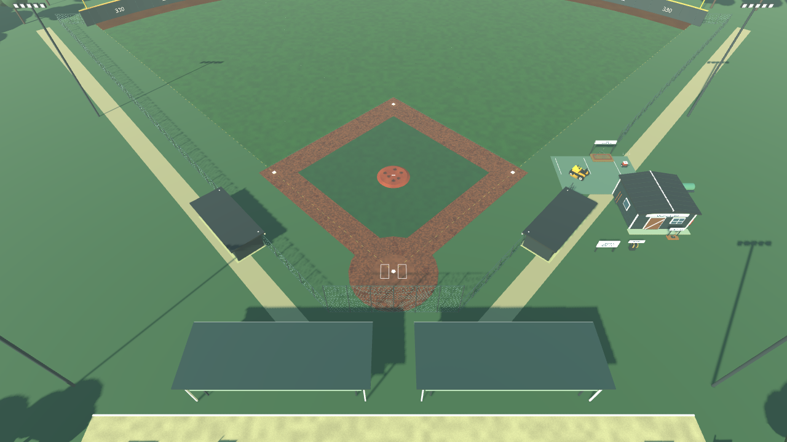
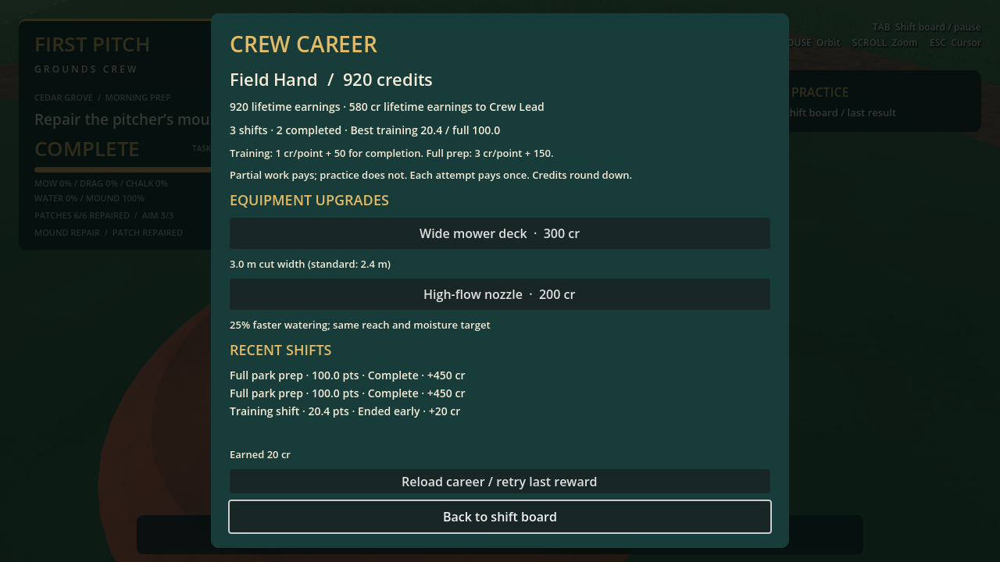

# First Pitch: Grounds Crew

A playable Godot 3D groundskeeping prototype set at **Cedar Grove Ballpark**. Mow the outfield, drag and water the dirt, chalk foul lines, and repair the mound. Take timed shifts or focused contracts, earn crew credits, climb the ranks, and buy permanent tool upgrades. Save field work and resume later.

Built with GDScript, procedural meshes and original generated sound effects. No plugins, downloaded art, or external runtime dependencies are required.

**Current build: M1–M5 prototypes implemented, plus the first M6 career and contracts loop.** The latest verified build passed **582 headless assertions** and scripted graphical checks. Windows and Forward+ hardware testing remain outstanding.



[Start playing](#start-playing) · [Controls](#controls) · [Field tools](#field-tools) · [Shifts and contracts](#shifts-and-contracts) · [Career and upgrades](#career-and-upgrades) · [Saving](#save-and-resume) · [Development](#development-and-verification)

## Current milestone status

| Milestone | Implemented |
| --- | --- |
| **M1 — Stadium and character** | Explorable ballpark, walking/sprinting/jumping, orbit camera, collisions, daylight, detailed groundskeeper and park props. |
| **M2 — Riding mower** | Enter/exit, acceleration, braking, reverse, steering, animated wheels, seated operator and speed-responsive engine audio. |
| **M3 — Grass mowing** | Persistent spatial cutting, directional stripes, disappearing grass tufts and overlap-safe coverage. |
| **M4 — Field tools** | Tow-behind infield drag, pushable chalk marker, on-foot hose and timed hand tamper; five independent field jobs. |
| **M5 — Shifts, scores and saving** | Free practice, training/full-park shifts, paused board, repair goals, finish quality, frozen results, manual save and autosave/paused resume. |
| **M6 — First career slice** | Credits, four crew ranks, personal bests, recent results, two permanent upgrades and four focused contracts with two rank unlocks. |
| **Guide and controller** | Seven-step first-run tutorial, checkpoint/skip/replay, InputMap Controls, pad tools/camera/menu navigation and saved sensitivity. |
| **Field and sound polish** | Field-facing dugouts connected to fencing/backstop, proper home plate and reference markings, positional tool sounds, ambience and saved volume settings. |

These are playable prototype systems, not a finished release. See the [roadmap](docs/ROADMAP.md), [verification record](docs/VERIFICATION.md) and [current limitations](#current-limitations).

## Start playing

Tested with **Godot 4.6.3 stable**. Import `project.godot` into Godot and press **F5**, or open `scenes/main/main.tscn` and press **F6**. The project defaults to **Forward+** for a desktop GPU. Windows PC is the intended platform; a Windows executable has not been exported or tested.

```sh
godot --editor --path .
godot --path .
```

For a device without Forward+ support, choose the Compatibility renderer or launch with:

```sh
godot --path . --rendering-method gl_compatibility
```

You spawn beside the workshop in **free practice**, with no countdown. The tractor, chalk marker, hose station and tamper rack are nearby. Use the open **GROUNDS CREW / FIELD ACCESS** entrance beside the workshop to reach the field.

1. Follow the first-run **Crew guide** through all five tools, or skip with **F8 / D-pad Up**. Finishing or skipping clears tutorial work; **Replay tutorial** on the board starts fresh practice.
2. Press **Tab** and choose training or game-day full prep, or open **Contracts** for a shorter job.
3. Complete its listed goals before the deadline, or use **End shift now** for a partial result.
4. Open **Crew career** to spend earned credits on equipment.
5. Quit normally to autosave your field and clock. Use **Save to manual slot** for a separate snapshot you control.

**Training, Morning mowing and Mound callout reset work. Full prep, Between-games infield and Doubleheader turnaround apply seeded game-day wear to the current park.** All starts park equipment. It keeps your career and upgrades, and does not overwrite the manual field slot unless you save again.

## Controls

| Action | Input |
| --- | --- |
| Walk / drive tractor / push chalk marker | WASD |
| Sprint on foot | Shift |
| Jump on foot / brake vehicle or marker | Space |
| Enter nearby tractor or chalk marker / leave when stopped | E |
| Swap mower deck / infield drag, on foot beside the parked tractor at the tool bay | Q |
| Raise drag / lower when stopped; open or close chalk gate while pushing | R |
| Take hose near its station / stow anywhere on foot | F |
| Take tamper near its rack / stow anywhere on foot | G |
| Spray while holding hose and cursor captured | Hold left mouse button |
| One timed stroke while holding tamper | Click left mouse button |
| Orbit third-person camera | Mouse |
| Zoom | Mouse wheel |
| Open/close shift board; pause/resume world and countdown | Tab |
| Release/recapture cursor during play; return from a board submenu | Escape |

**Escape during play does not pause the clock.** Tab does. Inside Contracts, Crew career or Sound settings, Escape returns to the paused main board; Tab resumes play.

The board's **Controls** screen reads the current InputMap and switches key/pad names with your last input device. Controller camera sensitivity saves automatically (default **2.2 rad/s**, adjustable **0.5–5.0**; stick deadzone **0.2**).

| Controller | Action |
| --- | --- |
| Left stick / click LS | Move / sprint |
| Right stick | Camera |
| A | Jump / brake; confirm menus |
| X | Enter / exit tractor or chalk marker |
| Y | Swap mower / drag at bay |
| B | Raise/lower drag or chalk gate; back in menus |
| LB / RB | Hose / tamper |
| RT | Spray / one timed tamp |
| Start | Shift board |
| Back | Cursor toggle / menu back |
| D-pad / A / B | Navigate / confirm / back |
| D-pad Up during guide | Skip tutorial |

A pad can aim and use hand tools while the mouse cursor is free. Switching back to the mouse restores the captured-cursor requirement. Tutorial progress and completion persist in local settings; the guide pauses during paid attempts. See [first-run guide](docs/screenshots/tutorial-first-run.png) and [controller Controls](docs/screenshots/controller-controls.png).

## Field tools

All five jobs track actual unique cells, line sections or accepted impacts. Overlapping work cannot inflate completion, and doing one job does not advance another. Whole-park readiness requires every job's exact full count; rounded HUD percentages cannot finish it early.

### Mowing

Approach the tractor until the E prompt appears, enter, and drive onto the outfield. Cutting is automatic with the mowing deck fitted. The standard **2.4 m** footprint leaves persistent directional stripes and removes uncut grass tufts. The career deck upgrade increases it to **3.0 m**.

Only the mowable outfield counts. Dirt, warning track and the decorative infield lawn are excluded. Stop before exiting; your cutting pattern remains visible. Driving supports acceleration, reverse, braking and speed-dependent steering, with protected dismount placement.

### Infield dragging

On foot beside the stopped tractor at the workshop bay, press **Q** to swap the mower deck for the drag. Swapping requires the tractor within **9 m** of the bay and the player within **3.5 m** of the tractor. The rack displays the unused attachment.

Enter, drive onto dirt, stop and press **R** to lower the drag. Forward travel smooths a swept **2.8 × 1.2 m** footprint, leaving lighter, fine-grooved dirt. Working speed is limited to **4 m/s**. Raise it at any time; lowering requires a stop. Reverse travel does not prepare dirt.

Grass, infield lawn, mound, bases and the batter/plate area are protected. Dirt preparation persists independently of mowing and moisture. The attachment uses arcade towing rather than articulated trailer physics.

### Chalk marker

The separate push cart is parked on the workshop pad. Use **E**, WASD, **R** for its gate, Space to brake, and E to leave after stopping. The visible operator walks behind its handle.

Foul lines begin as **dashed gold guides**. Push forward with the gate open to leave a persistent white trail. Reverse or stationary travel does not paint; leaving closes the gate. Close it before repositioning to avoid stray marks.

Both foul lines track approximately **0.25 m sections** from **0.8 to 103 m** from home. Strokes are **0.22 m wide**. Off-guide marks remain visible but earn no credit; bases and plate are protected. The HUD reports left/right and combined coverage.

Chalk is unlimited and is not erased by other tools yet. Batter's boxes, coaching boxes and on-deck circles are fixed reference markings, outside the chalk objective.

### Hose watering

Approach the water station beside the workshop, press **F**, aim at dirt and hold **LMB**. F stows the hose anywhere; entering the tractor or marker also stows it.

The **1.8 m radius** spray accumulates moisture with a softer edge. A valid dirt cell qualifies at **65% moisture**, so a quick pass may only dampen it. Wet dirt darkens without erasing drag grooves or chalk. The high-flow career nozzle delivers **25% more moisture per second**.

The hose reaches **65 m** from its station; the nozzle reaches **12 m**. Walls and colliders block spraying. Grass, lawn, mound, bases and the batter/plate area earn no water credit. Releasing the cursor stops spray.

There is no drying, overwatering penalty or limited water supply. The hose is a visual curve, not a simulated rope routed around obstacles.

### Mound repair

Take the tamper with **G** near the workshop rack. Walk onto the sloped mound, stop, aim at worn clay, and **click LMB**. Hold aim through impact. Each of **six patches** needs **three valid strokes**, for **18 impacts** total.

Accepted impacts visibly compact the clay and settle its clumps. Repaired patches cannot earn more work. Holding LMB does not repeat strokes. Moving, looking away, an obstacle, excessive distance or a released cursor prevents contact from counting.

G stows it anywhere. Hose and tamper are mutually exclusive; vehicle entry stows either. Stowing cancels unfinished strokes while preserving accepted work. Repair is compaction-based, without digging, clay inventory or deformable terrain.

Tool screenshots: [mowing](docs/screenshots/mowing.png), [dragging](docs/screenshots/dragging.png), [chalking](docs/screenshots/chalking.png), [watering](docs/screenshots/watering.png), [tamping](docs/screenshots/tamping.png).

## Shifts and contracts

Press **Tab** for the paused shift board. Training/full prep start from its main screen; shorter jobs live under **Contracts**.

| Job | Deadline | Goals | Maximum total pay | Availability |
| --- | --- | --- | --- | --- |
| Free practice | None | Explore and practice any task | No earnings | Always |
| Training shift | 15 min | Mow 25%; drag/chalk/water 50% each; mound 100% | **150 cr**, including 50 completion bonus | Always |
| Full park prep | 30 min | 100% of every job | **450 cr**, including 150 completion bonus | Always |
| Morning mowing | 10 min | Mow 10% | **100 cr**, including 40 completion bonus | Always |
| Mound callout | 5 min | Repair every mound patch | **40 cr**, including 15 completion bonus | Always |
| Between-games infield | 12 min | Drag 25% and water 25% | **150 cr**, including 60 completion bonus | Field Hand / 500 lifetime credits |
| Doubleheader turnaround | 8 min | Drag/water 75%; chalk/mound 100% | **300 cr**, including 100 completion bonus | Crew Lead / 1,500 lifetime credits |

Scores run from **0–100**, divided equally among listed jobs. Training and full prep award up to 20 points per job; single-job contracts use all 100 points for that job, and the infield contract divides them 50/50. Unlisted work earns no contract points. Full-completion goals still require exact task counts.

Game-day goals measure repairs against the damaged starting field: `(current − starting) / (total − starting)`. Nothing needing repair counts as complete. A first game day on a blank park creates a prepared baseline before applying wear; later game days wear your actual field. Grass regrows, dirt wears most in traffic areas, moisture dries, chalk scuffs and mound patches lose preparation.

Final score is coverage × finish quality, clamped to a **0.7–1.0** multiplier. Off-guide chalk, puddles and wet-drag ruts reduce quality; matching neighbouring mowing directions offer a small bonus. Quality affects pay but never blocks coverage completion. See [game-day wear](docs/screenshots/game-day-wear.png), [puddles and ruts](docs/screenshots/puddles-ruts.png) and [finish-quality results](docs/screenshots/finish-quality.png). Results show per-job quality and a tip for the biggest loss. At **0.95 moisture**, puddles block dragging for **12 seconds**; the HUD warns **OVERWATERING**. Dragging above **0.75 moisture** leaves ruts and warns **DRAGGING WET DIRT**. Let the dirt dry, then drag again to repair ruts. Puddle history still affects that attempt's quality.

Finishing the requested goals ends the attempt automatically. Running out of time or choosing **End shift now** records partial work. Partial pay is proportional to the work portion of the payout, rounded down; the bonus is only for completion. For example, a half-finished mound callout earns **12 cr**, while completing it earns **40 cr**.

Results freeze when the attempt ends. Later practice cannot change its score, goal count or payout. A completed contract says **CONTRACT COMPLETE**; it does not declare the entire park ready. Each attempt pays once, even when replayed from a saved field. A fresh start creates a new attempt.

Contracts are fixed, repeatable offers. You cannot replace an active attempt without finishing or ending it. Rank unlocks use lifetime earnings, so spending cannot relock them. Personal bests appear on the contract cards. Deadlines and payout balance still need human playtesting.


## Career and upgrades

Open **Tab → Crew career** for your wallet, lifetime earnings, rank, personal bests, latest five results and equipment shop. Career records retain up to **2,000 attempts**. Rewards and purchases save automatically, separately from field work.

| Crew rank | Lifetime earnings |
| --- | --- |
| Rookie | 0 cr |
| Field Hand | 500 cr |
| Crew Lead | 1,500 cr |
| Head Groundskeeper | 3,500 cr |

Spending credits never reduces rank progress. Training pays one credit per score point plus 50 for completion; full prep pays three per point plus 150. Contract terms appear on their cards. Free practice earns nothing.

| Permanent upgrade | Price | Effect |
| --- | --- | --- |
| Wide mower deck | **300 cr** | Actual cut width grows from 2.4 to 3.0 m; fitted and spare deck visuals widen too. |
| High-flow nozzle | **200 cr** | Moisture application is 25% faster, with unchanged spray radius, reach and target. |

Purchases apply immediately and survive fresh shifts, field loads and game restarts. Owned equipment cannot be bought twice. Loading an older field does not refund spending or roll back upgrades.

If a career write fails, no credits or purchases change. Use **Reload career / retry last reward** after addressing the file error. Damaged career files are preserved and financial changes stay blocked until readable again.



## Save and resume

**Autosave and the manual slot are separate.** Autosave writes when an attempt starts/finishes, when the board opens, on a normal window close, and every **60 seconds during an active attempt when field work changed**. Writes are queued at no more than one per second; they never run from physics processing. The footer shows **Autosaved hh:mm:ss**. A crash can lose about a minute of recent work. Full-field save time measured roughly **110–140 ms** on the test machine, so a brief save hitch is possible.

On launch, an active autosave or an unpaid finished attempt opens a paused **Resume last session** card with its title, remaining clock and goal progress. Choose Resume to restore work and park equipment at the workshop; the clock stays paused until you resume play. **Start fresh** discards that recovery choice and opens clean practice. Resuming a finished attempt claims its reward through the same once-only career ledger. A damaged autosave becomes `field-autosave.bad`, with a notice; startup continues.

Use **Save to manual slot** and **Load manual slot** on the board for an independent snapshot. It includes all five jobs, patterns, chalk, moisture, mound hits, clock, attempt ID, wear seed/baselines, puddles/ruts, quality state and frozen results. Loading replaces current work and parks equipment; positions, motion, held tools and camera angle are not restored. Autosave and fresh starts leave the manual disk slot intact. See [resume card](docs/screenshots/resume-card.png).

| Local file | Saved automatically? | Contains |
| --- | --- | --- |
| `user://field-save.dat` | No — manual Save button | Field work, active attempt/clock and last result. |
| `user://field-autosave.dat` | Yes — shift, dirty interval, board and quit triggers | Separate resumable field/attempt snapshot. |
| `user://settings.cfg` | Yes — tutorial/input changes | Guide checkpoint/completion and pad sensitivity. |
| `user://career.dat` | Yes — rewards and purchases | Earnings, paid attempts, rank progress, personal bests and owned upgrades. |
| `user://sound.cfg` | Yes — volume changes | Master/effects/ambience levels and mute. |

Use Godot's **Project → Open User Data Folder** to find these files. On Windows they are under the game's folder in `%APPDATA%/Godot/app_userdata/`. Saves are local, with no cloud/device sync or GitHub upload.

Missing, damaged or incompatible field files report an error and leave current work intact. Older field snapshots without attempt IDs remain loadable. Field slots now write version 3. Recorded Cedar Grove v1 and current-layout v2 slots migrate as fresh attempts with neutral quality, preserving old results and payouts. The v1 geometry migration preserves work and initializes added boundary cells unworked/dry. Future layout/format changes may require additional migration support.

## Sound and volume

The first audio pass includes **nine original generated clips**: mower engine, hose spray, drag friction, chalk-cart movement, footsteps, tamp impact, shift-result chime, wind and birds. Tool effects are positional, engine pitch follows speed, and tamp sound follows accepted contact. World audio pauses with the board; the preview/result chime can play while paused.

Open **Tab → Sound settings** for Master, Effects, Ambience and Mute all sound. Zero silences that channel. **Preview sound** plays a chime, and preferences save automatically. The game needs no audio-generation tools at runtime; developers can reproduce the WAV files with `python3 tools/generate_audio.py`.

## Cedar Grove Ballpark

The park has 27.43 m (90 ft) basepaths, a dirt infield, grass outfield and warning track, with a warm teal/cream/gold palette, daylight and shadows. It includes covered seating, open dugouts, a detailed workshop and tool bay, scoreboard, community signs, light towers, ticket booth, concourse props and a surrounding tree line.

Both dugouts face the diamond along the first-/third-base sides. Walk-in front-corner openings connect to a taller backstop and foul-side fencing returning to the padded outfield wall. Outside walkways anchor them to the park. The marked workshop equipment entrance stays open with its gate leaves folded away from the driving lane.

Home plate has the proper **17-inch five-sided shape**, pointing toward the catcher/backstop. Reference markings include **4 × 6 ft batter's boxes** with a 6-inch plate gap, **5 × 20 ft coaching boxes**, and **5 ft diameter on-deck circles** on clay pads. These marks are decorative and do not grant chalk coverage.

The character has procedural walking/tool poses and a separate seated mower visual. The mower has treaded wheels, fenders, grille, lights and steering animation. Uncut grass uses **28,000 mask-aware instanced tufts** that disappear when cut. Repeated seats use instancing, materials are shared, and 4× MSAA improves presentation.

More views: [full field](docs/screenshots/field-layout.png), [home area](docs/screenshots/home-area.png), [dugout front](docs/screenshots/visitor-dugout.png), [equipment access](docs/screenshots/field-access.png), [sound controls](docs/screenshots/sound-settings.png).

## Development and verification

The last feature pass verified **582 headless assertions**, editor import, main-scene startup and scripted graphical flows. These include actual tool work, native board/shop controls, saved-attempt replay protection, upgrades and contract completion. Graphical checks used Linux Xorg/Mesa **OpenGL Compatibility**; synthetic fixtures and fast-forwarded branches are identified in [VERIFICATION.md](docs/VERIFICATION.md).

Run from the project directory:

```sh
godot --headless --editor --path . --import --quit
godot --headless --path . --script tests/test_mowing.gd
godot --headless --path . --script tests/test_gameplay.gd
godot --headless --path . --script tests/test_infield.gd
godot --headless --path . --script tests/test_drag_gameplay.gd
godot --headless --path . --script tests/test_chalk.gd
godot --headless --path . --script tests/test_chalk_gameplay.gd
godot --headless --path . --script tests/test_moisture.gd
godot --headless --path . --script tests/test_watering_gameplay.gd
godot --headless --path . --script tests/test_mound.gd
godot --headless --path . --script tests/test_tamping_gameplay.gd
godot --headless --path . --script tests/test_shift_session.gd
godot --headless --path . --script tests/test_shift_gameplay.gd
godot --headless --path . --script tests/test_field_save.gd
godot --headless --path . --script tests/test_audio.gd
godot --headless --path . --script tests/test_field_layout.gd
godot --headless --path . --script tests/test_career.gd
godot --headless --path . --script tests/test_career_gameplay.gd
godot --headless --path . --script tests/test_contracts.gd
godot --headless --path . --script tests/test_field_layout_resource.gd
godot --headless --path . --script tests/test_field_wear.gd
godot --headless --path . --script tests/test_quality.gd
godot --headless --path . --script tests/test_tutorial.gd
godot --headless --path . --script tests/test_autosave.gd
godot --headless --path . --script tests/test_controller_input.gd
godot --headless --path . --quit-after 180
```

On restricted Linux hosts, set `XDG_DATA_HOME`, `XDG_CONFIG_HOME` and `XDG_CACHE_HOME` to writable directories. This is normally unnecessary on Windows. Scene fixtures use isolated career paths so test results do not alter player earnings.

Graphical scripts require a desktop or virtual display. Use the same launch pattern for any script below:

```sh
godot --path . --rendering-method gl_compatibility --script tests/test_contracts_visual.gd
```

| Graphical script | Coverage |
| --- | --- |
| `test_visual.gd` | Park, mower and mowing views. |
| `test_drag_visual.gd` | Attachment and before/after dirt preparation. |
| `test_chalk_visual.gd` | On-guide coverage and off-guide strokes. |
| `test_watering_visual.gd` | Station, aiming, spray and moisture comparison. |
| `test_tamping_visual.gd` | Rack, timed impacts and repaired patches. |
| `test_shift_visual.gd` | Native board controls, real work, restart and timeout. |
| `test_save_visual.gd` | Native save/load into a recreated scene. |
| `test_sound_visual.gd` | Volume/mute controls and recorded mixer preview. |
| `test_field_layout_visual.gd` | Field, dugouts, gate, plate and reference markings. |
| `test_career_visual.gd` | Real earnings, native shop purchases and upgraded deck. |
| `test_onboarding_visual.gd` | First launch, native skip/replay, pad menus and persisted paused resume. |
| `test_wear_visual.gd` | Game-day start, worn field, puddles/ruts, quality results and Crew Lead card. |
| `test_contracts_visual.gd` | Real mound-contract completion, rank lock/unlock and focused goals. |

Captures use `/tmp/firstpitch-*.png` on Linux. These scripts run controlled automated scenarios; normal play uses the main scene. Intermittent audio playback-resource warnings have appeared during test-process teardown; see the verification record.

### Project map

| Area | Entry points |
| --- | --- |
| Main scene and interactions | `scenes/main/main.tscn`, `scripts/gameplay/game.gd` |
| Shared park geometry | `scripts/gameplay/field_layout.gd`, `resources/layouts/cedar_grove.tres` |
| Stadium and reference markings | `scripts/gameplay/stadium.gd`, `scripts/environment/park_props.gd`, `scripts/environment/field_markings.gd` |
| Player, mower and appearance | `scripts/player/`, `scripts/vehicles/mower.gd`, `scripts/vehicles/mower_visual.gd` |
| Mowing and dirt preparation | `scripts/mowing/grass.gd`, `scripts/infield/`, `scripts/vehicles/drag_attachment.gd` |
| Chalking, watering and mound repair | `scripts/chalking/`, `scripts/watering/`, `scripts/mound/` |
| Profiles, clock, goals and contracts | `scripts/gameplay/shift_session.gd`, `scripts/gameplay/shift_director.gd` |
| Field saves, career and audio | `scripts/gameplay/field_save.gd`, `scripts/gameplay/career_profile.gd`, `scripts/gameplay/grounds_audio.gd`, `scripts/gameplay/sound_preferences.gd` |
| Guide, autosave and input | `scripts/gameplay/tutorial.gd`, `crew_autosave.gd`, `crew_input.gd`, `crew_settings.gd` |
| HUD and board screens | `scripts/ui/` |

`FieldLayout` is the shared source for park dimensions, base positions, height queries, mask bounds and equipment placements. Duplicate `resources/layouts/cedar_grove.tres` and assign the copy to `game.gd` to configure another park; see the layout section in the learning notes. Reusable scenes under `scenes/environment/` retain resolution overrides, spray rate/reach and mound stroke requirements. A zero mask resolution uses the layout default. Prototype geometry builds at startup; inspect the editor's **Remote** scene tree while running. See [LEARNING_NOTES.md](docs/LEARNING_NOTES.md) for implementation explanations and tuning guidance.

## Current limitations

- One procedural prototype park. No authored character rigs, crowds, playable baseball, additional parks or park-unlock progression yet.
- Coverage and finish-quality scoring are implemented. Human deadline/pay balancing and deeper career progression remain future work.
- Arcade vehicle handling and mostly flat ground; no suspension, articulated trailer physics, deformable terrain or physical hose simulation.
- Unlimited supplies; drying is limited to game-day moisture loss and puddle timers. No clay inventory, chalk erasing or repainting of static reference markings.
- One manual slot and one autosave, a 2,000-attempt local career ledger, no equipment resale and no cloud sync. Loading parks equipment rather than restoring its exact position.
- Synthetic prototype sound; no music, crowds, surface-specific footsteps or acoustic occlusion. Desktop listening and mix tuning remain outstanding.
- Windows exports, native Windows behavior, Forward+ GPU appearance/performance and physical controller hardware remain unverified. Controller mappings and tool/menu operation pass injected-event tests.
- Park dimensions and exclusions now share one layout resource; there is no visual layout-authoring UI. Field v1/v2 migrations support the recorded Cedar Grove layouts; future geometry changes need an explicit migration.
