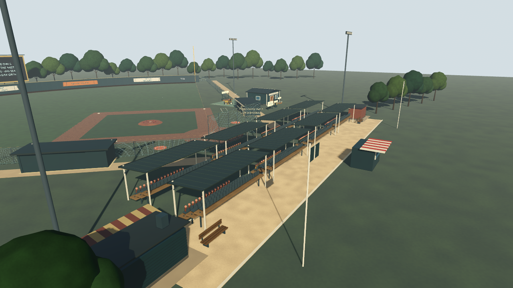
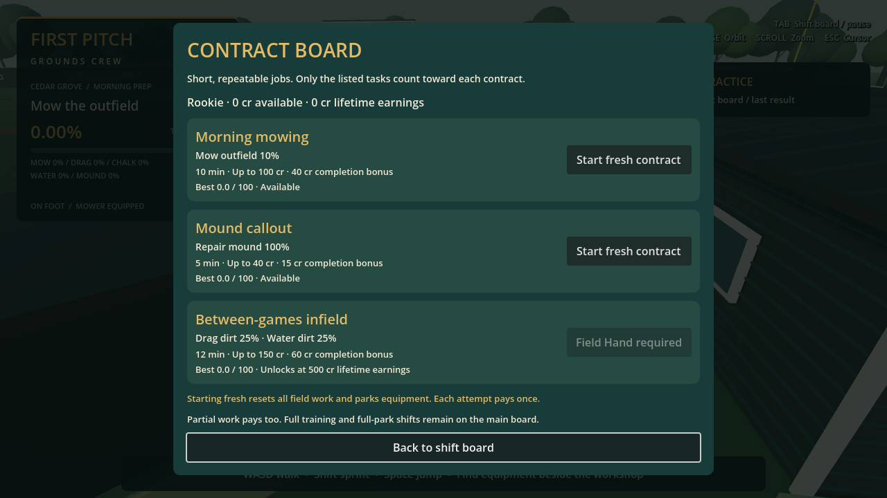
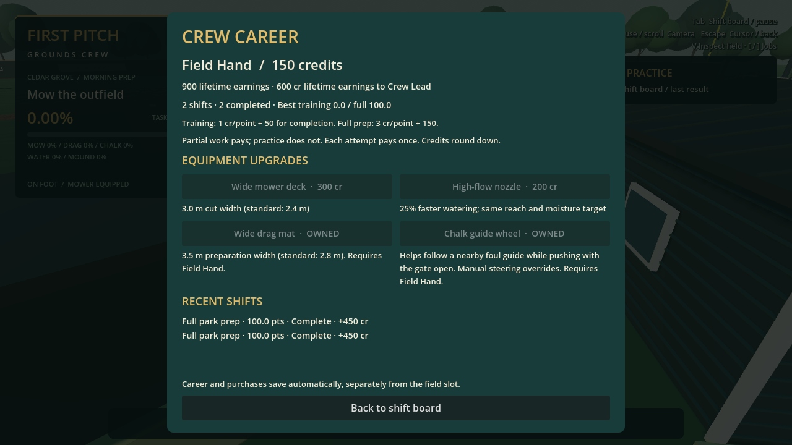

# First Pitch: Grounds Crew

A playable Godot 3D groundskeeping prototype set at **Cedar Grove Ballpark**. Mow the outfield, drag and water the dirt, chalk foul lines, and repair the mound. Take timed shifts or focused contracts, earn crew credits, climb the ranks, and buy permanent tool upgrades. Take a job with the **Cedar Grove Owls**, grow a supporter base, and reinvest home-game income in tools and a bigger ballpark. Save field work and resume later.

Built with GDScript, procedural meshes and original generated sound effects. No plugins, downloaded art, or external runtime dependencies are required.

**Current build: M1–M5 prototypes, rotating game-day conditions, paid manager priorities, postgame recaps, six stadium projects and visual revisions.** The latest progression/stadium-life pass verified **513 targeted assertions** and rendered gameplay checks. The earlier full-suite baseline was 715 assertions; see [verification history](docs/VERIFICATION.md) for subsequent feature checks. Windows and native Forward+ hardware testing remain outstanding.



[Start playing](#start-playing) · [Controls](#controls) · [Club story](#club-story-loop) · [Field tools](#field-tools) · [Shifts and contracts](#shifts-and-contracts) · [Career and upgrades](#career-and-upgrades) · [Saving](#save-and-resume) · [Development](#development-and-verification)

## Current milestone status

| Milestone | Implemented |
| --- | --- |
| **M1 — Stadium and character** | Explorable ballpark, walking/sprinting/jumping, orbit camera, collisions, daylight, detailed groundskeeper and park props. |
| **M2 — Riding mower** | Enter/exit, acceleration, braking, reverse, steering, animated wheels, seated operator and speed-responsive engine audio. |
| **M3 — Grass mowing** | Persistent spatial cutting, directional stripes, disappearing grass tufts and overlap-safe coverage. |
| **M4 — Field tools** | Tow-behind infield drag, pushable chalk marker, on-foot hose and timed hand tamper; five independent field jobs. |
| **M5 — Shifts, scores and saving** | Free practice, training/full-park shifts, paused board, repair goals, finish quality, frozen results, manual save and autosave/paused resume. |
| **M6 — Club and career** | Owls story chapters, starter tools, home-game prep/hosting, supporters, gate income, six stadium projects, four tool upgrades, crew ranks, rotating conditions, manager priorities and postgame recaps. |
| **Guide and controller** | Seven-step first-run tutorial, checkpoint/skip/replay, InputMap Controls, pad tools/camera/menu navigation and saved sensitivity. |
| **Field and sound polish** | Field-facing dugouts connected to fencing/backstop, proper home plate and reference markings, positional tool sounds, ambience and saved volume settings. |

These are playable prototype systems, not a finished release. See the [roadmap](docs/ROADMAP.md), [verification record](docs/VERIFICATION.md) and [current limitations](#current-limitations).

## Start playing

Tested with **Godot 4.6.3 stable**. Import `project.godot` into Godot and press **F5**, or open `scenes/main/main.tscn` and press **F6**. The project defaults to **Forward+** for a desktop GPU. Windows PC is the intended platform; a Windows executable has not been exported or tested.

```sh
godot --editor --path .
godot --path .
```

For a device without Forward+ support, choose the Compatibility renderer or launch with:

```sh
godot --path . --rendering-method gl_compatibility
```

You spawn beside the workshop in **free practice**, with no countdown. The tractor, chalk marker, hose station and tamper rack are nearby. Use the open **GROUNDS CREW / FIELD ACCESS** entrance beside the workshop to reach the field.

1. Follow the first-run **Crew guide** through all five tools, or skip with **F8 / D-pad Up**. Finishing or skipping clears tutorial work; **Replay tutorial** on the board starts fresh practice.
2. Press **Tab → Start club story → Take the groundskeeper job** to begin the Owls campaign. Existing training/full-prep shifts and Contracts stay available.
3. Complete the home-game priority checklist, then open **Clubhouse → Host home game** to gain supporters and net ticket income.
4. Reinvest the shared budget: **Buy better tools / Workshop** for equipment, or **Clubhouse** for seating and amenities.
5. Quit normally to autosave your field and clock. Use **Save to manual slot** for a separate snapshot you control.

**Training, Morning mowing and Mound callout reset work. Full prep, Between-games infield, Doubleheader turnaround and club home prep apply seeded game-day wear to the current park.** All starts park equipment. It keeps your career and upgrades, and does not overwrite the manual field slot unless you save again.

## Controls

| Action | Input |
| --- | --- |
| Walk / drive tractor / push chalk marker | WASD |
| Sprint on foot | Shift |
| Jump on foot / brake vehicle or marker | Space |
| Enter nearby tractor or chalk marker / leave when stopped | E |
| Swap mower deck / infield drag, on foot beside the parked tractor at the tool bay | Q |
| Raise drag / lower when stopped; open or close chalk gate while pushing | R |
| Take hose near its station / stow anywhere on foot | F |
| Take tamper near its rack / stow anywhere on foot | G |
| Spray while holding hose and cursor captured | Hold left mouse button |
| One timed stroke while holding tamper | Click left mouse button |
| Orbit third-person camera | Mouse |
| Zoom | Mouse wheel |
| Toggle field inspection | V |
| Previous / next job | [ / ] |
| Open/close shift board; pause/resume world and countdown | Tab |
| Release/recapture cursor during play; return from a board submenu | Escape |

**Escape during play does not pause the clock.** Tab does. Inside Contracts, Crew career or Sound settings, Escape returns to the paused main board; Tab resumes play.

The board's **Controls** screen reads the current InputMap and switches key/pad names with your last input device. Controller camera sensitivity saves automatically (default **2.2 rad/s**, adjustable **0.5–5.0**; stick deadzone **0.2**).

| Controller | Action |
| --- | --- |
| Left stick / click LS | Move / sprint |
| Right stick | Camera |
| A | Jump / brake; confirm menus |
| X | Enter / exit tractor or chalk marker |
| Y | Swap mower / drag at bay |
| B | Raise/lower drag or chalk gate; back in menus |
| LB / RB | Hose / tamper |
| RT | Spray / one timed tamp |
| Start | Shift board |
| RS click | Toggle field inspection |
| D-pad Left / Right during play | Previous / next job |
| Back | Cursor toggle / menu back |
| D-pad / A / B | Navigate / confirm / back |
| D-pad Up during guide | Skip tutorial |

A pad can aim and use hand tools while the mouse cursor is free. Switching back to the mouse restores the captured-cursor requirement. Tutorial progress and completion persist in local settings; the guide pauses during paid attempts. See [first-run guide](docs/screenshots/tutorial-first-run.png) and [controller Controls](docs/screenshots/controller-controls.png).

## Club story loop

You work for the fictional **Cedar Grove Owls**, a struggling Low-A minor-league team. General manager **Mara Vale** guides five short progression chapters: keep the gates open, win returning supporters, make the park a family night out, build a covered stand, and grow the town's club.

Open **Tab → Start club story** to accept the job. A new club begins with **48 supporters**, **120 seats** and weaker equipment: **1.8 m mower deck**, **2.4 m drag mat**, and **0.65 watering rate**. Purchased tools and earned credits from an existing career carry over; owned equipment is never downgraded. The sandbox stays unchanged until you enroll.

1. **Prepare a home game.** The opener’s 20-minute checklist asks for mowing 15%, repairing 50% of damaged dirt, all missing chalk, watering 50%, and finishing mound repairs. Later dates rotate hot afternoons, rain recovery and doubleheader turnaround with distinct goals, starting conditions and clocks. Goals use the existing game-day baselines and quality scoring. Volunteers handle routine work beyond your assigned checklist.
2. **Host the home game.** A fully completed prep attempt pays up to **160 cr**, then unlocks one home-game settlement. Attendance depends on supporters and prep quality, capped by seating. Tickets and food minus operating costs add net money to the shared club budget, and good experiences attract more supporters. A clean first date brings 48 attendees, **84 cr net** and **20 new supporters**—244 cr including prep pay.
3. **Choose what to improve.** Tools make work faster/easier; seating accommodates demand; amenities increase income and fan growth. Side contracts also fund the budget, but cash or idle time alone never creates supporters or gate money.
4. **Repeat.** The next date wears the park again. Completed-but-unhosted prep survives quitting and is offered on resume; an attempt can never pay ticket income twice.

| Stadium investment | Cost | Requirements | Effect |
| --- | ---: | --- | --- |
| Community bleachers | 600 cr | 90 supporters | Add 120 seats: **240 total**. |
| Family snack shack | 450 cr | 75 supporters | New concession building; 1 cr food profit per attendee and 3 extra supporters per game. |
| Covered grandstand | 1,400 cr | 200 supporters; both earlier projects | Covered seating and 240 more seats: **480 total**; 1 cr more per ticket and 5 extra supporters per game. |

The stadium visibly grows and batched spectators show the last hosted crowd. Story, budget, supporters, construction and tool ownership persist together in the career file. Construction parks the crew without clearing field work. Starting home prep ends a running practice guide; Replay tutorial remains available.

**This first story slice uses simulated home-game summaries**, not playable baseball innings, win/loss simulation or an animated match. Volunteers complete routine field work only after your paid attempt ends, so their work creates no extra coverage pay. Prices, checklist length and growth rates need human balance testing.

[Clubhouse story](docs/screenshots/club-story.png) · [Starter park](docs/screenshots/club-starter.png) · [Expanded covered park](docs/screenshots/club-grown-stadium.png) · [Supporters](docs/screenshots/club-supporters.png)

## Field inspection

Press **V / RS click** to inspect the selected job. Use **[ / ]** or **D-pad Left / Right** to cycle jobs; during a paid attempt, cycling follows its requested jobs. Equipping a tool still selects that tool's job.

Gold highlights unfinished grass/dirt, missing chalk sections or mound patches needing impacts. Teal shows prepared/qualified cells; orange shows ruts and blue shows puddles. The legend reports exact remaining counts and ruts. Water readiness uses the actual qualified-cell flags, including cells close to the moisture threshold. Completed chalk sections lose their gold bars and repaired mound patches lose their discs as you work.

Inspection is a temporary view. It changes no work, quality, score, pay or saved field data. Starting a job, replaying the guide or loading a field clears it. Press the same button again to return to normal visuals. Screenshots: [grass](docs/screenshots/inspection-grass.png), [dirt/ruts/puddles](docs/screenshots/inspection-dirt.png), [missing chalk](docs/screenshots/inspection-chalk.png).

## Field tools

All five jobs track actual unique cells, line sections or accepted impacts. Overlapping work cannot inflate completion, and doing one job does not advance another. Whole-park readiness requires every job's exact full count; rounded HUD percentages cannot finish it early.

### Mowing

Approach the tractor until the E prompt appears, enter, and drive onto the outfield. Cutting is automatic with the mowing deck fitted. The standard **2.4 m** footprint leaves persistent directional stripes and removes uncut grass tufts. The career deck upgrade increases it to **3.0 m**.

Only the mowable outfield counts. Dirt, warning track and the decorative infield lawn are excluded. Stop before exiting; your cutting pattern remains visible. Driving supports acceleration, reverse, braking and speed-dependent steering, with protected dismount placement.

### Infield dragging

On foot beside the stopped tractor at the workshop bay, press **Q** to swap the mower deck for the drag. Swapping requires the tractor within **9 m** of the bay and the player within **3.5 m** of the tractor. The rack displays the unused attachment.

Enter, drive onto dirt, stop and press **R** to lower the drag. Forward travel smooths a swept **2.8 × 1.2 m** footprint, leaving lighter, fine-grooved dirt. Working speed is limited to **4 m/s**. Raise it at any time; lowering requires a stop. Reverse travel does not prepare dirt.

Grass, infield lawn, mound, bases and the batter/plate area are protected. Dirt preparation persists independently of mowing and moisture. The attachment uses arcade towing rather than articulated trailer physics.

### Chalk marker

The separate push cart is parked on the workshop pad. Use **E**, WASD, **R** for its gate, Space to brake, and E to leave after stopping. The visible operator walks behind its handle.

Foul lines begin as **dashed gold guides**. Push forward with the gate open to leave a persistent white trail. Reverse or stationary travel does not paint; leaving closes the gate. Close it before repositioning to avoid stray marks.

Both foul lines track approximately **0.25 m sections** from **0.8 to 103 m** from home. Strokes are **0.22 m wide**. Off-guide marks remain visible but earn no credit; bases and plate are protected. The HUD reports left/right and combined coverage.

Chalk is unlimited and is not erased by other tools yet. Batter's boxes, coaching boxes and on-deck circles are fixed reference markings, outside the chalk objective.

### Hose watering

Approach the water station beside the workshop, press **F**, aim at dirt and hold **LMB**. F stows the hose anywhere; entering the tractor or marker also stows it.

The **1.8 m radius** spray accumulates moisture with a softer edge. A valid dirt cell qualifies at **65% moisture**, so a quick pass may only dampen it. Wet dirt darkens without erasing drag grooves or chalk. The high-flow career nozzle delivers **25% more moisture per second**.

The hose reaches **65 m** from its station; the nozzle reaches **12 m**. Walls and colliders block spraying. Grass, lawn, mound, bases and the batter/plate area earn no water credit. Releasing the cursor stops spray.

There is no drying, overwatering penalty or limited water supply. The hose is a visual curve, not a simulated rope routed around obstacles.

### Mound repair

Take the tamper with **G** near the workshop rack. Walk onto the sloped mound, stop, aim at worn clay, and **click LMB**. Hold aim through impact. Each of **six patches** needs **three valid strokes**, for **18 impacts** total.

Accepted impacts visibly compact the clay and settle its clumps. Repaired patches cannot earn more work. Holding LMB does not repeat strokes. Moving, looking away, an obstacle, excessive distance or a released cursor prevents contact from counting.

G stows it anywhere. Hose and tamper are mutually exclusive; vehicle entry stows either. Stowing cancels unfinished strokes while preserving accepted work. Repair is compaction-based, without digging, clay inventory or deformable terrain.

Tool screenshots: [mowing](docs/screenshots/mowing.png), [dragging](docs/screenshots/dragging.png), [chalking](docs/screenshots/chalking.png), [watering](docs/screenshots/watering.png), [tamping](docs/screenshots/tamping.png).

## Shifts and contracts

Press **Tab** for the paused shift board. Training/full prep start from its main screen; shorter jobs live under **Contracts**, and the club story uses **Clubhouse**.

| Job | Deadline | Goals | Maximum total pay | Availability |
| --- | --- | --- | --- | --- |
| Free practice | None | Explore and practice any task | No earnings | Always |
| Owls opening-day prep | 20 min | Mow 15%; drag/water 50%; chalk/mound 100% | **160 cr** prep pay, plus variable game income | Accept the Clubhouse job |
| Owls hot afternoon | 20 min | Mow 15%; drag 25%; chalk/mound 100%; water 90% | **160 cr** prep + gate + optional **35 cr** manager bonus | After opener, rotating |
| Owls rain recovery | 20 min | Mow 10%; drag 75%; chalk/mound 100%; no watering | **160 cr** prep + gate + optional **40 cr** manager bonus | After hot date, rotating |
| Owls doubleheader prep | 15 min | Mow 10%; drag 75%; chalk/mound 100%; water 25% | **160 cr** prep + gate + optional **50 cr** manager bonus | After rain date, rotating |
| Training shift | 15 min | Mow 25%; drag/chalk/water 50% each; mound 100% | **150 cr**, including 50 completion bonus | Always |
| Full park prep | 30 min | 100% of every job | **450 cr**, including 150 completion bonus | Always |
| Morning mowing | 10 min | Mow 10% | **100 cr**, including 40 completion bonus | Always |
| Mound callout | 5 min | Repair every mound patch | **40 cr**, including 15 completion bonus | Always |
| Between-games infield | 12 min | Drag 25% and water 25% | **150 cr**, including 60 completion bonus | Field Hand / 500 lifetime credits |
| Doubleheader turnaround | 8 min | Drag/water 75%; chalk/mound 100% | **300 cr**, including 100 completion bonus | Crew Lead / 1,500 lifetime credits |

Scores run from **0–100**, divided equally among listed jobs. Training and full prep award up to 20 points per job; single-job contracts use all 100 points for that job, and the infield contract divides them 50/50. Unlisted work earns no contract points. Full-completion goals still require exact task counts.

Game-day goals measure repairs against the damaged starting field: `(current − starting) / (total − starting)`. Nothing needing repair counts as complete. A first game day on a blank park creates a prepared baseline before applying wear; later game days wear your actual field. Grass regrows, dirt wears most in traffic areas, moisture dries, chalk scuffs and mound patches lose preparation.

Final score is coverage × finish quality, clamped to a **0.7–1.0** multiplier. Off-guide chalk, puddles and wet-drag ruts reduce quality; matching neighbouring mowing directions offer a small bonus. Quality affects pay but never blocks coverage completion. See [game-day wear](docs/screenshots/game-day-wear.png), [puddles and ruts](docs/screenshots/puddles-ruts.png) and [finish-quality results](docs/screenshots/finish-quality.png). Results show per-job quality and a tip for the biggest loss. At **0.95 moisture**, puddles block dragging for **12 seconds**; the HUD warns **OVERWATERING**. Dragging above **0.75 moisture** leaves ruts and warns **DRAGGING WET DIRT**. Let the dirt dry, then drag again to repair ruts. Puddle history still affects that attempt's quality.

Finishing the requested goals ends the attempt automatically. Running out of time or choosing **End shift now** records partial work. Partial pay is proportional to the work portion of the payout, rounded down; the bonus is only for completion. For example, a half-finished mound callout earns **12 cr**, while completing it earns **40 cr**.

Results freeze when the attempt ends. Later practice cannot change its score, goal count or payout. A completed contract says **CONTRACT COMPLETE**; it does not declare the entire park ready. Each attempt pays once, even when replayed from a saved field. A fresh start creates a new attempt.

Contracts are fixed, repeatable offers. You cannot replace an active attempt without finishing or ending it. Rank unlocks use lifetime earnings, so spending cannot relock them. Personal bests appear on the contract cards. Deadlines and payout balance still need human playtesting.



## Career and upgrades

Open **Tab → Crew career** (called **Workshop** in the club story) for your wallet, lifetime earnings, rank, personal bests, latest five results and equipment shop. Career records retain up to **2,000 attempts**. Rewards and purchases save automatically, separately from field work.

| Crew rank | Lifetime earnings |
| --- | --- |
| Rookie | 0 cr |
| Field Hand | 500 cr |
| Crew Lead | 1,500 cr |
| Head Groundskeeper | 3,500 cr |

Spending credits never reduces rank progress. Training pays one credit per score point plus 50 for completion; full prep pays three per point plus 150. Contract terms appear on their cards. Free practice earns nothing. In the club story, net game income also contributes to lifetime earnings; construction spending does not remove rank progress.

| Permanent upgrade | Price | Unlock | Effect |
| --- | --- | --- | --- |
| Wide mower deck | **300 cr** | Always | Cut width grows from 2.4 to 3.0 m; fitted and spare deck visuals widen too. |
| High-flow nozzle | **200 cr** | Always | 25% faster watering; unchanged spray radius, reach and target. |
| Wide drag mat | **400 cr** | Field Hand / 500 lifetime credits | Preparation width grows from 2.8 to 3.5 m; mounted and parked mat visuals match. |
| Chalk guide wheel | **350 cr** | Field Hand / 500 lifetime credits | Helps hold a nearby foul guide while pushing forward with the gate open. Manual steering overrides. |

Story upgrades replace the weaker starter kit: mower 1.8 → 3.0 m, drag 2.4 → 3.5 m, hose 0.65 → 1.0.

Purchases apply immediately and survive fresh shifts, field loads and game restarts. Owned equipment cannot be bought twice. Loading an older field does not refund spending or roll back upgrades.

The guide wheel works in either travel direction along a foul line. Line up within **0.65 m** and **30°** of a guide, open the gate and push forward. The HUD shows **GUIDE WHEEL** while it assists. Steering, braking, reversing or closing the gate returns control to you. It only corrects heading: chalk still paints at the nozzle’s actual position, and off-guide marks still reduce quality. The wider drag uses the same protected areas, puddle blocking and wet-dirt rut rules as the standard mat.

If a career write fails, no credits or purchases change. Use **Reload career / retry last reward** after addressing the file error. Damaged career files are preserved and financial changes stay blocked until readable again.



Upgrade views: [wide drag preparing dirt](docs/screenshots/wide-drag.png), [guide wheel chalking](docs/screenshots/chalk-guide-wheel.png).

## Save and resume

**Autosave and the manual slot are separate.** Autosave writes when an attempt starts/finishes, when the board opens, on a normal window close, and every **60 seconds during an active attempt when field work changed**. Writes are queued at no more than one per second; they never run from physics processing. The footer shows **Autosaved hh:mm:ss**. A crash can lose about a minute of recent work. Full-field save time measured roughly **110–140 ms** on the test machine, so a brief save hitch is possible.

On launch, an active autosave, an unpaid finished attempt, or paid home prep that still needs hosting opens a paused **Resume last session** card with its title, remaining clock and goal progress. Choose Resume to restore work and park equipment at the workshop; the clock stays paused until you resume play. **Start fresh** discards that recovery choice and opens clean practice. Resuming a finished attempt claims its reward through the same once-only career ledger. A damaged autosave becomes `field-autosave.bad`, with a notice; startup continues.

Use **Save to manual slot** and **Load manual slot** on the board for an independent snapshot. It includes all five jobs, patterns, chalk, moisture, mound hits, clock, attempt ID, wear seed/baselines, puddles/ruts, quality state and frozen results. Loading replaces current work and parks equipment; positions, motion, held tools and camera angle are not restored. Autosave and fresh starts leave the manual disk slot intact. See [resume card](docs/screenshots/resume-card.png).

| Local file | Saved automatically? | Contains |
| --- | --- | --- |
| `user://field-save.dat` | No — manual Save button | Field work, active attempt/clock and last result. |
| `user://field-autosave.dat` | Yes — shift, dirty interval, board and quit triggers | Separate resumable field/attempt snapshot. |
| `user://settings.cfg` | Yes — tutorial/input changes | Guide checkpoint/completion and pad sensitivity. |
| `user://career.dat` | Yes — rewards, projects and purchases | Earnings, paid attempts, tools, crew ranks and the club story/event ledger. |
| `user://sound.cfg` | Yes — volume changes | Master/effects/ambience levels and mute. |

Use Godot's **Project → Open User Data Folder** to find these files. On Windows they are under the game's folder in `%APPDATA%/Godot/app_userdata/`. Saves are local, with no cloud/device sync or GitHub upload.

Missing, damaged or incompatible field files report an error and leave current work intact. Older field snapshots without attempt IDs remain loadable. Field slots now write version 3. Recorded Cedar Grove v1 and current-layout v2 slots migrate as fresh attempts with neutral quality, preserving old results and payouts. The v1 geometry migration preserves work and initializes added boundary cells unworked/dry. Future layout/format changes may require additional migration support.

## Sound and volume

The first audio pass includes **nine original generated clips**: mower engine, hose spray, drag friction, chalk-cart movement, footsteps, tamp impact, shift-result chime, wind and birds. Tool effects are positional, engine pitch follows speed, and tamp sound follows accepted contact. World audio pauses with the board; the preview/result chime can play while paused.

Open **Tab → Sound settings** for Master, Effects, Ambience and Mute all sound. Zero silences that channel. **Preview sound** plays a chime, and preferences save automatically. The game needs no audio-generation tools at runtime; developers can reproduce the WAV files with `python3 tools/generate_audio.py`.

## Cedar Grove Ballpark

The park has 27.43 m (90 ft) basepaths, a dirt infield, grass outfield and warning track, with a warm teal/cream/gold palette, daylight and shadows. It includes covered seating, open dugouts, a detailed workshop and tool bay, scoreboard, community signs, light towers, ticket booth, concourse props and a surrounding tree line.

Both dugouts face the diamond along the first-/third-base sides. Walk-in front-corner openings connect to a taller backstop and foul-side fencing returning to the padded outfield wall. Outside walkways anchor them to the park. The marked workshop equipment entrance stays open with its gate leaves folded away from the driving lane.

Home plate has the proper **17-inch five-sided shape**, pointing toward the catcher/backstop. Reference markings include **4 × 6 ft batter's boxes** with a 6-inch plate gap, **5 × 20 ft coaching boxes**, and **5 ft diameter on-deck circles** on clay pads. These marks are decorative and do not grant chalk coverage.

The character has procedural walking/tool poses and a separate seated mower visual. The mower has treaded wheels, fenders, grille, lights and steering animation. Uncut grass uses **28,000 mask-aware instanced tufts** that disappear when cut. Repeated seats use instancing, materials are shared, and 4× MSAA improves presentation.

More views: [full field](docs/screenshots/field-layout.png), [home area](docs/screenshots/home-area.png), [dugout front](docs/screenshots/visitor-dugout.png), [equipment access](docs/screenshots/field-access.png), [sound controls](docs/screenshots/sound-settings.png).

## Development and verification

The club-story full-suite baseline verified **715 headless assertions**, editor import, main-scene startup and scripted graphical flows. Later targeted feature results are recorded in the verification history. These include actual tool work, native board/shop controls, saved-attempt replay protection, upgrades and contract completion. Graphical checks used Linux Xorg/Mesa **OpenGL Compatibility**; synthetic fixtures and fast-forwarded branches are identified in [VERIFICATION.md](docs/VERIFICATION.md).

Run from the project directory:

```sh
godot --headless --editor --path . --import --quit
godot --headless --path . --script tests/test_mowing.gd
godot --headless --path . --script tests/test_gameplay.gd
godot --headless --path . --script tests/test_infield.gd
godot --headless --path . --script tests/test_drag_gameplay.gd
godot --headless --path . --script tests/test_chalk.gd
godot --headless --path . --script tests/test_chalk_gameplay.gd
godot --headless --path . --script tests/test_moisture.gd
godot --headless --path . --script tests/test_watering_gameplay.gd
godot --headless --path . --script tests/test_mound.gd
godot --headless --path . --script tests/test_tamping_gameplay.gd
godot --headless --path . --script tests/test_shift_session.gd
godot --headless --path . --script tests/test_shift_gameplay.gd
godot --headless --path . --script tests/test_field_save.gd
godot --headless --path . --script tests/test_audio.gd
godot --headless --path . --script tests/test_field_layout.gd
godot --headless --path . --script tests/test_career.gd
godot --headless --path . --script tests/test_career_gameplay.gd
godot --headless --path . --script tests/test_contracts.gd
godot --headless --path . --script tests/test_field_layout_resource.gd
godot --headless --path . --script tests/test_field_wear.gd
godot --headless --path . --script tests/test_quality.gd
godot --headless --path . --script tests/test_tutorial.gd
godot --headless --path . --script tests/test_autosave.gd
godot --headless --path . --script tests/test_controller_input.gd
godot --headless --path . --script tests/test_inspection.gd
godot --headless --path . --script tests/test_equipment_upgrades.gd
godot --headless --path . --script tests/test_club_progress.gd
godot --headless --path . --script tests/test_club_gameplay.gd
godot --headless --path . --quit-after 180
```

On restricted Linux hosts, set `XDG_DATA_HOME`, `XDG_CONFIG_HOME` and `XDG_CACHE_HOME` to writable directories. This is normally unnecessary on Windows. Scene fixtures use isolated career paths so test results do not alter player earnings.

Graphical scripts require a desktop or virtual display. Use the same launch pattern for any script below:

```sh
godot --path . --rendering-method gl_compatibility --script tests/test_contracts_visual.gd
```

| Graphical script | Coverage |
| --- | --- |
| `test_visual.gd` | Park, mower and mowing views. |
| `test_drag_visual.gd` | Attachment and before/after dirt preparation. |
| `test_chalk_visual.gd` | On-guide coverage and off-guide strokes. |
| `test_watering_visual.gd` | Station, aiming, spray and moisture comparison. |
| `test_tamping_visual.gd` | Rack, timed impacts and repaired patches. |
| `test_shift_visual.gd` | Native board controls, real work, restart and timeout. |
| `test_save_visual.gd` | Native save/load into a recreated scene. |
| `test_sound_visual.gd` | Volume/mute controls and recorded mixer preview. |
| `test_field_layout_visual.gd` | Field, dugouts, gate, plate and reference markings. |
| `test_career_visual.gd` | Real earnings, native shop purchases and upgraded deck. |
| `test_club_visual.gd` | Native story enrollment, home-game hosting, construction, workshop and growing stadium/crowds. |
| `test_equipment_visual.gd` | Native rank-locked shop purchases, wider drag work and assisted chalking. |
| `test_inspection_visual.gd` | Five inspection views, exact missing-section markers and Controls. |
| `test_onboarding_visual.gd` | First launch, native skip/replay, pad menus and persisted paused resume. |
| `test_wear_visual.gd` | Game-day start, worn field, puddles/ruts, quality results and Crew Lead card. |
| `test_contracts_visual.gd` | Real mound-contract completion, rank lock/unlock and focused goals. |

Captures use `/tmp/firstpitch-*.png` on Linux. These scripts run controlled automated scenarios; normal play uses the main scene. Intermittent audio playback-resource warnings have appeared during test-process teardown; see the verification record.

### Project map

| Area | Entry points |
| --- | --- |
| Main scene and interactions | `scenes/main/main.tscn`, `scripts/gameplay/game.gd` |
| Shared park geometry | `scripts/gameplay/field_layout.gd`, `resources/layouts/cedar_grove.tres` |
| Stadium and reference markings | `scripts/gameplay/stadium.gd`, `scripts/environment/park_props.gd`, `scripts/environment/field_markings.gd` |
| Player, mower and appearance | `scripts/player/`, `scripts/vehicles/mower.gd`, `scripts/vehicles/mower_visual.gd` |
| Mowing and dirt preparation | `scripts/mowing/grass.gd`, `scripts/infield/`, `scripts/vehicles/drag_attachment.gd` |
| Chalking, watering and mound repair | `scripts/chalking/`, `scripts/watering/`, `scripts/mound/` |
| Profiles, clock, goals and contracts | `scripts/gameplay/shift_session.gd`, `scripts/gameplay/shift_director.gd` |
| Field saves, career and audio | `scripts/gameplay/field_save.gd`, `scripts/gameplay/career_profile.gd`, `scripts/gameplay/grounds_audio.gd`, `scripts/gameplay/sound_preferences.gd` |
| Field inspection | `scripts/gameplay/crew_inspection.gd`, grass/infield state shaders |
| Minor-league club story | `club_progress.gd`, `club_director.gd`, `club_stadium.gd`, `scripts/ui/club_panel.gd` |
| Guide, autosave and input | `scripts/gameplay/tutorial.gd`, `crew_autosave.gd`, `crew_input.gd`, `crew_settings.gd` |
| HUD and board screens | `scripts/ui/` |

`FieldLayout` is the shared source for park dimensions, base positions, height queries, mask bounds and equipment placements. Duplicate `resources/layouts/cedar_grove.tres` and assign the copy to `game.gd` to configure another park; see the layout section in the learning notes. Reusable scenes under `scenes/environment/` retain resolution overrides, spray rate/reach and mound stroke requirements. A zero mask resolution uses the layout default. Prototype geometry builds at startup; inspect the editor's **Remote** scene tree while running. See [LEARNING_NOTES.md](docs/LEARNING_NOTES.md) for implementation explanations and tuning guidance.

## Current limitations

- One procedural prototype park. No authored character rigs, animated crowds, playable baseball, additional parks or park-unlock progression yet. Club spectators are simple batched figures and home games are summaries.
- Coverage and finish-quality scoring are implemented. Human deadline/pay balancing and deeper career progression remain future work.
- Arcade vehicle handling and mostly flat ground; no suspension, articulated trailer physics, deformable terrain or physical hose simulation.
- Unlimited supplies; drying is limited to game-day moisture loss and puddle timers. No clay inventory, chalk erasing or repainting of static reference markings.
- One manual slot and one autosave, a 2,000-attempt local career ledger, no equipment resale and no cloud sync. Loading parks equipment rather than restoring its exact position.
- Synthetic prototype sound; no music, crowd audio, surface-specific footsteps or acoustic occlusion. Desktop listening and mix tuning remain outstanding.
- Windows exports, native Windows behavior, Forward+ GPU appearance/performance and physical controller hardware remain unverified. Controller mappings and tool/menu operation pass injected-event tests.
- Park dimensions and exclusions now share one layout resource; there is no visual layout-authoring UI. Field v1/v2 migrations support the recorded Cedar Grove layouts; future geometry changes need an explicit migration.

### Home seasons and manager targets

The Clubhouse now shows a repeating six-date home schedule, with named visiting clubs and Mara's briefing before each game. Legacy home-game results retain their original score/time season targets. New condition dates use the same manager request for the season review and cash bonus. Finish the checklist and host even if you miss the request; prep wages and gate income still apply.

The season review tracks hosted dates, targets met and average prep score. After the finale it stays visible until you host the next season's opener. Fans, buildings, equipment and budget carry forward. The review is reconstructed from saved hosting history, including existing careers; opponents are story context, with no simulated baseball wins or losses.

Schedule regression test: `godot --headless --path . --script tests/test_club_schedule.gd`.

### More stadium investments

Open **Tab → Clubhouse** and scroll through the stadium projects. The original bleachers, snack shack and covered grandstand keep their prices and benefits. New projects:

| Project | Cost | Supporters | Prerequisites | Extra benefit per home game |
| --- | ---: | ---: | --- | --- |
| Owls grill stand | 900 cr | 150 | Snack shack | +1 cr food profit per attendee, +3 fans |
| Electronic scoreboard | 1,100 cr | 120 | None | +1 cr per ticket, +2 fans |
| Owls video board | 2,600 cr | 320 | Electronic scoreboard and covered grandstand | Another +1 cr per ticket, +6 fans |

The grill adds a striped concession building and picnic tables behind the stands. Scoreboard tiers replace the existing outfield board; the video screen displays club supporters and capacity with an owl graphic. Benefits stack and apply to future hosted games. Purchases use the shared club budget and persist through season rollover and reloads. The video board is a static club display, with baseball games still simulated.

Expansion regression test: `godot --headless --path . --script tests/test_stadium_expansion.gd`.

Watering: take the hose at its station with **F** (controller **LB**), then hold **left mouse** (**RT**) to spray. The stream now remains visible when aiming into the air or against obstacles; only reachable, unobstructed dirt gains moisture. Aim down and hold steady until **AIM** reaches **TARGET**. If the cursor is free, **Esc** recaptures it. The tutorial now explicitly tells you to release the chalk cart before picking up the hose and displays live spray blockers/moisture.

### Visual direction

The ballpark now uses more natural character proportions, softened tractor shapes, organic foliage, subdued paint and workwear, material grain, warmer daylight and more detailed stadium/concession construction. See the [four-pass art review and before/after screenshots](docs/ART_REVIEW.md). Field work, purchases and saved progress retain their existing rules.

The close-up refinement adds molded seating and rails, stocked concession serving displays, varied batched crowd details, articulated walking knees/boots and tractor lens/vent details. Updated screenshots are in the [art review](docs/ART_REVIEW.md#close-up-refinement).

The park entrance now includes a paved ticket plaza, mounted signs, lamps, bins and planted borders. Subtle slab paving connects the concourse, and low hills frame the outfield beyond the trees. See the [entrance and surroundings review](docs/ART_REVIEW.md#entrance-and-surroundings), including the normal player-camera view.

Field visuals now include a softer mound profile, irregular worn clay that blends away as it is repaired, shorter bent grass tufts, smoother visible mowing edges and chalk guides that fade at distance. Exact scoring, repair targets and inspection masks retain their existing behavior. See the [field surface comparison](docs/ART_REVIEW.md#field-surface-refinement).

### Conditions, manager priorities and postgame recaps

Use **Tab → Clubhouse → Prepare**. Opening Day stays familiar; subsequent home dates rotate through these conditions, continuing across season boundaries:

| Condition | Field/work change | Manager request | Bonus paid when hosted |
| --- | --- | --- | ---: |
| Hot afternoon | Drier soil, 90% watering repair goal | Water-job quality at least 95%, total score at least 85, finish within 18 min | 35 cr |
| Rain recovery | Standing puddles drain in about 12 unpaused game seconds; 75% dirt repair, no watering goal | Dirt-job quality at least 95%, total score at least 85, finish within 18 min | 40 cr |
| Doubleheader | Heavier wear, 75% dirt repair and a 15-minute clock | Finish all assigned work, score at least 90, within 12 min | 50 cr |

The active HUD shows the condition, its practical advice and Mara's request. Rain puddles block dragging until they drain to workable moisture. Natural rain is not recorded as player overwatering; spraying and dragging still use the usual quality rules. These are starting field conditions, not continuous weather simulation.

Hosting opens a recap with **prep wages already received + gate profit + manager bonus**, the ticket/food/cost breakdown, attendance, fan growth, request result with actual quality/score/time, current budget and progress toward the next tool and stadium upgrade. The Continue button moves focus to the next date’s preparation button. The Clubhouse follows controller focus when scrolling.

Manager bonuses use the original recorded result and settle once with hosting. Missing a request does not block hosting or take away prep/gate earnings. Existing wages, hosted games and old manager-free results are unchanged; loading an old field cannot pay a bonus twice. Saved active conditions retain their profile, work baselines and puddle timers.

Tests: `test_game_day.gd` (rules, ledger and replay) and `test_game_day_gameplay.gd` (live fields, HUD, saves and recap). Screenshots: [hot-day briefing](docs/screenshots/loop-hot-day.png), [rain recovery](docs/screenshots/loop-rain-recovery.png), [postgame recap](docs/screenshots/loop-postgame.png).

### Progression, stadium life and ownership

The starter hose and drag are a little more forgiving: **0.65 application rate** and a **2.4 m mat**. The mower remains 1.8 m. Purchased equipment still reaches 1.0 watering rate, 3.5 m drag and 3.0 m mower width. Existing prices, payouts and manager rules are unchanged. A deterministic progression audit compares tools-first and seats-first strategies; see [balance review](docs/BALANCE_REVIEW.md) for its assumptions and purchase dates.

After hosting, a **3.2-second gates-opening view** shows the park and plays a crowd cheer/gate cue before revealing the recap. **Enter / A / click** continues; **Esc / B** skips. The world and shift clock stay paused. Skipping does not alter earnings or start the next date. Failed or duplicate hosting and career reloads do not replay the presentation.

When you return to the postgame park, spectators murmur and occasionally react. Built concession stands have localized counter sounds. Paid prep hides spectators and fades their audio out. Crowd/concession sounds and cheers use the existing **Ambience** control; the gate cue uses **Effects**, and Master/mute controls both. Sounds are original synthetic prototype clips.

Every **six hosted dates**, Mara gives an **ownership review**: season targets, average prep score, supporters, seats and season earnings. She sets a concrete next-season goal: gain 80 supporters and open the next stadium project, buy a missing tool if the stadium is complete, or meet four manager targets once everything is owned. Fan targets cap at 10,000. The goal is fixed from the finale's saved state, and the following finale records whether you met its deadline. Later purchases cannot change the original assignment or rewrite a missed objective. Reviews add no extra money and survive reloads without new save fields.

[Opening the gates](docs/screenshots/payoff-gates.png) · [Mara's season review](docs/screenshots/payoff-ownership.png)
