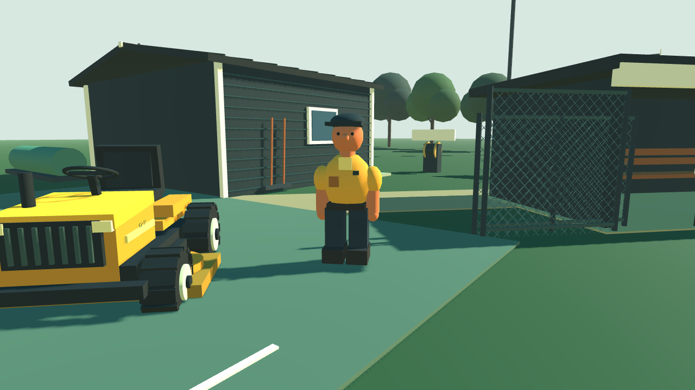
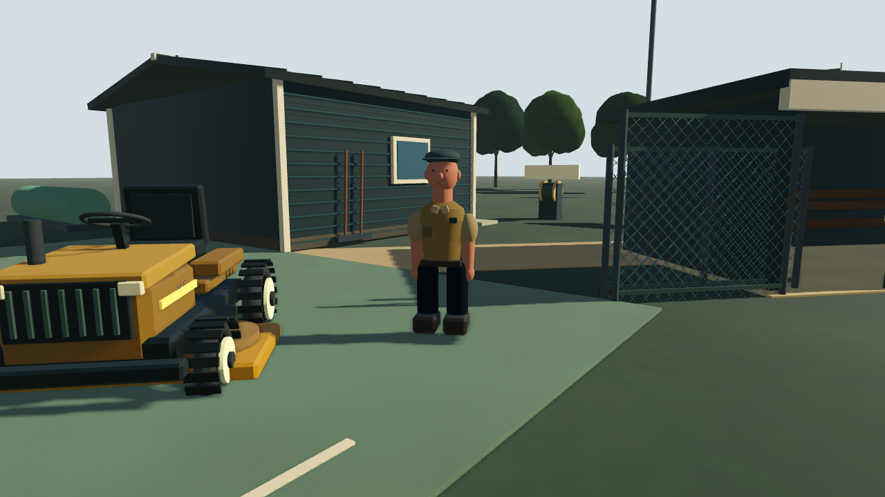
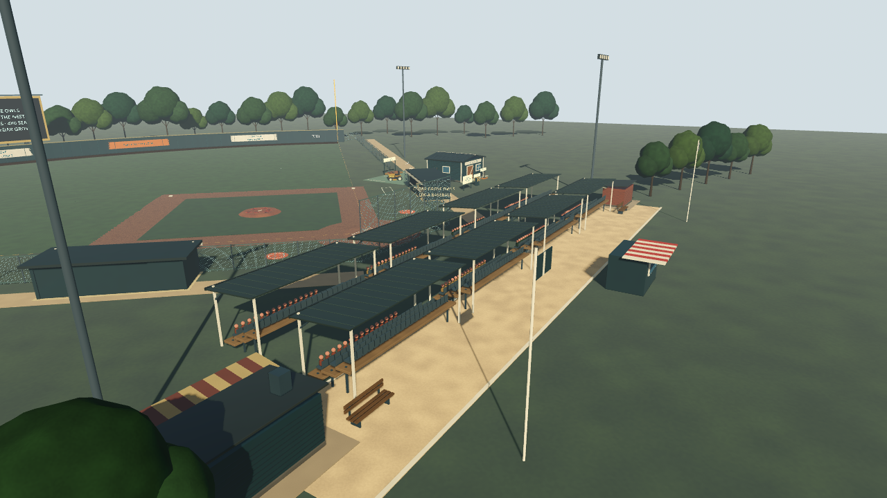
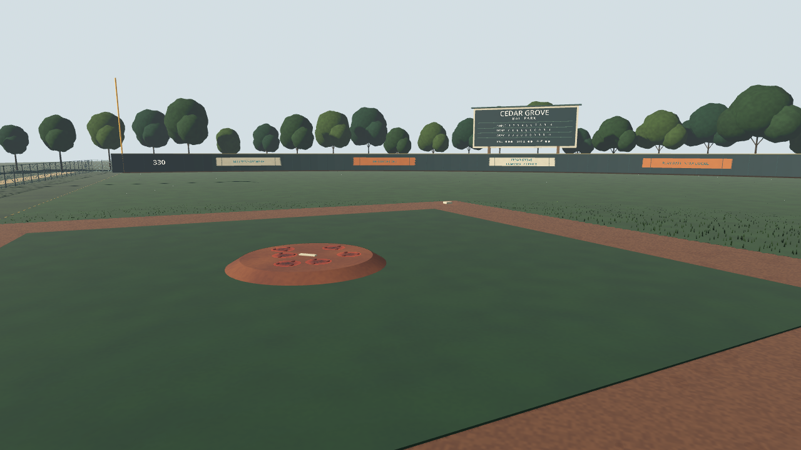
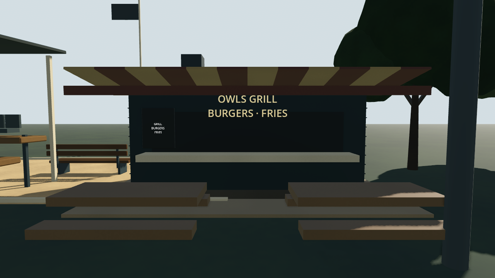

# Ballpark art review

Direction: stylized 3D with believable proportions, restrained painted finishes and recognizable material differences. Keep the small-town park character while moving away from toy-scale features and bright, uniform blocks.

## Four passes

1. **Shapes.** Revised the groundskeeper's head/body ratio, cap, clothes, limbs and footwear; introduced cached chamfered equipment meshes and tire forms; replaced spherical tree clusters with irregular smooth canopies and tapered trunks.
2. **Materials.** Shifted toward workwear khaki, weathered timber, muted stadium paint and clay. Added reusable paint, timber, cloth and concrete finishes. Reduced broad dirt mottling and bright grass contrast.
3. **Lighting.** Warmer angled sunlight, cooler ambient fill, less haze and a quieter sky. Configured softer directional light and Forward+ ambient occlusion. Corrected an overly bright intermediate material pass before retaining the final palette.
4. **Consistency and detail.** Tailored torso silhouette and facial details; roof pitches, standing seams, brackets, concession siding/plinths, slimmer fabric awnings and menu signage; rounded batched crowd bodies; finer foliage variation and lit grass tufts.

Five views were captured at each stage: workshop, field, crew/equipment, grown stadium and concessions. Intermediate captures remain in the temporary review directory; the following baseline and final views are committed for review.

## Crew and equipment

Before:



After:



## Final park views







## Reproduce the captures

Use isolated data, configuration and cache directories to avoid touching a playing career:

```bash
mkdir -p /tmp/firstpitch-art/{data,config,cache}
XDG_DATA_HOME=/tmp/firstpitch-art/data \
XDG_CONFIG_HOME=/tmp/firstpitch-art/config \
XDG_CACHE_HOME=/tmp/firstpitch-art/cache \
godot --path . --rendering-method gl_compatibility \
  --script tools/capture_art_review.gd -- review
```

The helper uses dedicated fixture paths, advances a synthetic club career to show all stadium projects and writes five screenshots to `/tmp/firstpitch-art`. It is an art-review tool, not a balance playthrough.

## Verification scope

219 assertions passed across gameplay, watering, tutorial, equipment upgrades, club gameplay, stadium expansion, shared layout and field-save suites. Editor import and rendered captures were checked for script/shader errors. Existing collider bounds, layout resources, task masks, upgrade costs and save formats are retained.

Rendered review used Godot 4.6.3, Linux Xorg and Mesa Compatibility. A Forward+ launch was attempted but the host lacks `VK_KHR_surface` and falls back to Compatibility; native Forward+ AO/soft-shadow appearance and Windows performance still need hardware verification. This remains procedural stylized art, with room for further character animation and bespoke models.
